## Operator profile

Cybersecurity and SOC analyst focused on alert triage, incident response, threat analysis, vulnerability management, digital forensics, and clear evidence handling across Windows and Linux environments. I combine hands-on security labs with IT support experience, documentation discipline, and an evidence-first approach: projects are published as complete only when their steps, detections, outputs, and sanitized proof can be reproduced.

> **Current mission:** building 10 SOC portfolio operations plus a dedicated Splunk SOC Analyst Level 1 lab series. Repository shells are public; implementation evidence will be added as each lab is completed and validated.

<table>
  <tr>
    <td align="center"><strong>4.0 / 4.0</strong> Cybersecurity GPA</td>
    <td align="center"><strong>15+</strong> IT issues handled weekly</td>
    <td align="center"><strong>99%</strong> User satisfaction</td>
    <td align="center"><strong>95%</strong> IAM issues within SLA</td>
    <td align="center"><strong>100%</strong> Critical escalations</td>
  </tr>
</table>

## Security operations toolkit

### SOC, SIEM, detection and telemetry

### Identity, endpoints and Microsoft administration

### DFIR, vulnerability and risk

### Network security and threat hunting

### Automation, development and data

### Threat intelligence, platforms and IT operations

### Analyst practices

## Portfolio operations

Every repository below is public and linked now. Status labels deliberately distinguish prepared packages, active builds, and planned work from completed evidence.

| # | Repository | Mission | Status |
|---:|---|---|---|
| 01 | [SOC Monitoring & Incident Response](https://github.com/RanvirSingh-Ronnie/soc-monitoring-incident-response) | Windows/Sysmon telemetry, SIEM triage, playbooks and case evidence | 🟡 Evidence pending |
| 02 | [Threat Intel IOC Checker](https://github.com/RanvirSingh-Ronnie/threat-intel-ioc-checker) | Explainable IOC enrichment and analyst-ready exports | 🟡 Validation pending |
| 03 | [SIEM Detection Engineering](https://github.com/RanvirSingh-Ronnie/siem-detection-engineering) | Version-controlled detections, fixtures, CI and ATT&CK coverage | 🟡 SIEM proof pending |
| 04 | [Windows Event Hunter](https://github.com/RanvirSingh-Ronnie/windows-event-hunter) | Endpoint hunting across logons, services, tasks and process chains | ⚪ Planned |
| 05 | [Identity Attack & Detection Lab](https://github.com/RanvirSingh-Ronnie/identity-attack-detection-lab) | Authorized AD simulations paired with detection and remediation | ⚪ Planned |
| 06 | [Home SOC Lab Blueprint](https://github.com/RanvirSingh-Ronnie/home-soc-lab-blueprint) | Reproducible Windows/Linux/SIEM lab infrastructure | 🔵 Lab build in progress |
| 07 | [Phishing Triage & Email Forensics](https://github.com/RanvirSingh-Ronnie/phishing-triage-email-forensics) | Headers, authentication, IOC extraction and analyst reporting | ⚪ Planned |
| 08 | [Network Detection & Threat Hunting Lab](https://github.com/RanvirSingh-Ronnie/network-detection-threat-hunting-lab) | Zeek, Suricata, Wireshark, PCAP replay and hunt reports | ⚪ Planned |
| 09 | [SOC Automation & Incident Orchestration](https://github.com/RanvirSingh-Ronnie/soc-automation-incident-orchestration) | Enrichment, case flow, approval gates and audit trails | ⚪ Planned |
| 10 | [Ransomware Detection & Response Lab](https://github.com/RanvirSingh-Ronnie/ransomware-detection-response-lab) | Harmless simulation, timelines, containment and recovery validation | ⚪ Planned |
| 11 | [Splunk SOC Analyst Level 1](https://github.com/RanvirSingh-Ronnie/splunk-soc-analyst-level-1) | Windows/Sysmon lab plus BOTS v1 investigation series | 🔵 In progress |

> Portfolio project links continue to open the matching **Projects Underway** page until each repository contains reproducible implementation and sanitized evidence.

## Hands-on security evidence

- **Incident response and DFIR:** created Windows and Linux disk images with FTK Imager and WinFE; examined artifacts in Autopsy; built timelines, used YARA, and maintained chain-of-custody documentation.
- **SOC monitoring and threat analysis:** worked with Splunk, IBM QRadar, and AlienVault OSSIM; correlated IOCs and logs, distinguished false positives from actionable events, and documented incidents.
- **Vulnerability management:** used OpenVAS/Greenbone, CVE and CVSS data to validate findings, prioritize risk, track remediation, and communicate outcomes.

## Experience

**IT Support Technician Intern — triOS College, Brampton, Ontario**  
*May 2025 – August 2025*

- Resolved 15+ issues weekly across endpoints, identity, access and learning/printing environments while maintaining 99% user satisfaction.
- Closed 95% of IAM issues within SLA using Active Directory and Microsoft Entra ID; access-process improvements increased efficiency by 20%.
- Escalated 100% of critical incidents, improved ticket accuracy and closure quality by 15%, and maintained 100% SLA adherence.
- Supported Microsoft Intune, Defender, Teams, ScreenConnect, Brightspace, PaperCut and PXE imaging workflows; documented work in Jira Service Management and Confluence.

## Education, certifications and recognition

| Category | Credential |
|---|---|
| Education | **Postgraduate Certificate, Cybersecurity** — Sault College, Jan 2024–Aug 2025 · GPA 4.0/4.0 · distinction (90%) |
| Education | **Bachelor of Computer Applications** — Punjabi University Patiala, May 2019–May 2022 · GPA 3.07/4.0 |
| Certification | **CompTIA Security+** · **ISC2 Certified in Cybersecurity (CC)** · **IBM Cybersecurity Analyst Professional Certificate** |
| Additional learning | **XM Cyber Exposure Management** · **AWS AI Practitioner Challenge** · **CompTIA CySA+ — in progress** |
| Recognition | **President's Academic Excellence Award 2024–2025** · Perfect Attendance/Honours (Feb & Apr 2025) · Sault College CTF participant |

## GitHub signal

## Responsible-use statement

All attack simulations are performed only in isolated, authorized lab environments. Published material will use harmless test behavior, sanitized evidence, reproducible defensive steps, and no redistributed restricted datasets or secrets.

**Open to cybersecurity, SOC, incident response and security operations opportunities.**

